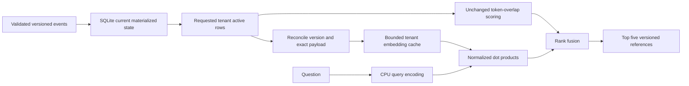

# Lesson 03 — When Lexical Search Stops Being Enough

## The question and the control

Can a small local dense encoder recover evidence that distinct-token overlap misses, without breaking the state model? This lesson compares three retrieval paths over the same replayed SQLite snapshot. It does not generate an answer or establish incident causality. The eight original questions and versioned evidence labels remain unchanged.

The clean Lesson 02 branch head is `af8dd44ddee49acd1c2b9a7b6ab3553863291bf1`. Before implementation, all 37 tests passed and a fresh ten-repeat lexical run independently reproduced macro required Recall@5 of **0.7714**, with complete evidence in **4/7** positive cases. The previous baseline artifact remains unchanged. The new [comparison report](../../benchmarks/results/lesson-03/comparison.md) and [raw measurements](../../benchmarks/results/lesson-03/comparison.json) record the three-mode experiment, including actual ranked failures. [Provenance](../../benchmarks/results/lesson-03/provenance.json) records the implementation snapshot rather than implying that a dirty working tree is a committed release.

## What exact words get right

The lexical baseline scores the number of distinct query tokens present in title or body. Unicode alphanumeric tokens, case folding, equal field treatment and document-ID tie ordering remain unchanged. Default searches still return at most five positive-overlap results. An additive keyword-only `top_k` argument allows the hybrid path to inspect more candidates without changing legacy calls.

This is useful for literal identifiers, error names and configuration terms. It is inspectable: `matched_tokens` explains each contribution. It needs no downloaded weights, has no encoder startup cost, and keeps the standard-library import and test path intact. Its weakness is that a query about shoppers being unable to finish paying can have little overlap with a source about payment-client acquisition. Common words can also overwhelm the few discriminating words. Exact overlap is a useful baseline, but it is not a model of equivalent meaning.

## Dense representation and its limits

`SentenceTransformerEncoder` lazily loads the pinned `sentence-transformers/all-MiniLM-L6-v2` revision `1110a243fdf4706b3f48f1d95db1a4f5529b4d41` with `device='cpu'` and `local_files_only=True`. Missing weights fail locally. There is no fallback download. Optional dependencies are imported only inside model loading; `from services.retrieval import Retriever` requires no ML packages.

An encoder implements `encode(texts)`, returning one vector for each input. Documents use exactly `title + ' ' + body`; metadata and evidence references are not embedded. Queries use the same encoder. MiniLM produces 384-dimensional vectors. The retriever independently validates batch count, dimension, finite coordinates and nonzero norm, then normalizes every vector. A dot product between unit vectors is cosine similarity. Larger values indicate closer directions in this representation; they are not probabilities that a document supports the question. Even a wholly unsupported question has nearest neighbors.

Model tokenization and sequence truncation apply before encoding. The measured maximum sequence length is included in configuration. Longer sources can lose information beyond that boundary. Chunking is not part of this small-document experiment. The fake-encoder tests check the retrieval contract independently of the real model; CI needs no cache or network.

## State and index lifecycle



SQLite remains authoritative. Every dense search obtains active rows for the requested tenant in one SQL snapshot. Cached entries include the exact source version and serialized payload. Unchanged entries are reused; changed or new entries are encoded in one batch. The replacement snapshot excludes absent entries, including tombstones, and is published only after all changed embeddings validate. A failed encode raises and preserves the previous internally consistent cache and LRU order; retries reconcile against current SQL state before returning results. Higher-version restoration gets a new vector. Duplicate and stale events retain the current vector. Restart starts with an empty index and rebuilds from current state.

The cache holds at most two requested tenants using least-recently-used eviction. Each retained tenant holds at most one vector per document identity. A retained inactive tenant may have an older cached snapshot, but it is reconciled before use. Repeated updates do not accumulate historical vectors. No administrative all-tenant scan feeds the encoder. Tenant switches can incur indexing cost on a miss. The first experiment retained one tenant and repeatedly rebuilt as the fixture crossed tenant boundaries: dense p95 was about 1.21 seconds. The two-tenant bound removes that avoidable churn for this workload, without assuming unlimited tenant storage.

This is synchronous code using the SQLite connection's owning thread. Hybrid uses a savepoint so lexical and dense candidates see the same read snapshot, including when the caller already owns a transaction. Before fusion, it rejects candidates outside the requested tenant's observed active identities and versions; failure paths release the savepoint. A WAL-backed integration test commits a newer version from another connection between candidate computations: the first hybrid call returns only the prior snapshot and the next returns only the new version. Search promises a consistent snapshot, not visibility of a write committed after that snapshot began. Tenant predicates protect retrieval boundaries; they do not authenticate callers.

## Hybrid rank fusion

Each candidate list contributes `1 / (k + rank)` for a document, starting ranks at one. Default `k=60`; candidate depth is 20 per mode, final `top_k=5`. A missing rank contributes zero. Lexical retains only positive matches; dense can supply all active documents up to the depth. Scores are rank contributions rather than a blend of incomparable token counts and cosine values.

Fusion keys are `(tenant_id, document_id, source_version)`. Versions and tenants never share a key. Duplicate identities within one list fail explicitly. Equal fused scores use full identity ascending; within one tenant snapshot this agrees with document-ID ordering. Candidate depth can change the outcome, and top_k above depth cannot invent additional candidates. RRF does not guarantee better recall: a weak lexical preference can push a useful dense result below rank five.

## What the measurements establish

The original eight cases yield lexical **0.7714**, dense **0.9000**, hybrid **0.8286** macro required Recall@5. Dense retrieves complete evidence for **5/7** positive cases; hybrid and lexical do so for **4/7**. Dense raises Precision@5 from **0.4857** to **0.5429**, while hybrid reaches **0.5143**. There are zero observed tenant/version violations, ranking changes across repetitions, or query errors in the recorded runs.

The improvement is specific. ACME-001 moves from two of five required sources to four with dense retrieval. PR-1842 remains missing. ACME-003 retrieves only one of its two required documents in all modes; PR-1842 remains missing there too. Dense recovers RB-002 for ACME-004, completing its two-source set. Hybrid drops RB-002 again. All three return five unsupported results for ACME-006. The ranked IDs in the comparison make these failures reviewable.

The deployment's association with PR-1842 could motivate a separate link-following experiment. A reference is an edge to inspect, not automatically supporting evidence. This lesson does not expand graphs or silently count linked references as retrieved evidence. Likewise, no cosine threshold is treated as calibrated abstention. A labeled validation set and separate decision policy would be needed to test that problem. Freshness SLOs and answer grounding remain later lessons.

Three exploratory paraphrases live outside the original fixture. They inherit evidence labels from ACME-001, ACME-004 and ACME-007 by explicit base-case ID; they cannot independently relabel evidence. They were authored during this lesson after inspecting the original dense failures, so they are exploratory, not a held-out test. On them lexical recall is **0.1667**, dense **0.6333**, hybrid **0.7333**. The reversal of dense/hybrid order across query sets is a reason to examine failure cases, not choose a universal winner.

## Measurement contract and CPU costs

Every mode validates the unchanged dataset, replays it into a new temporary database, verifies the manifest, and records a hash of the full active snapshot. The comparison checks identical snapshot hashes. Original relevance results use seven positive cases; the unsupported case is reported separately. Required recall uses exact tenant/document/version labels. Optional supporting sources receive precision credit but cannot satisfy required coverage. Precision@5 always divides by five, including empty slots as zero. The legacy precision-over-returned-count field remains available and reports null for empty lists. Complete coverage is the fraction of positive cases with every required source returned. Errors are disclosed separately and mark quality summaries partial.

Each original mode runs eight queries ten times, in fixture order: 80 timing samples but only eight relevance cases. Search latency includes storage, reconciliation, query encoding and ranking. The first tenant's 18 documents are preindexed; that cost and model loading are separate setup fields. The first BetaShop query builds six embeddings inside timed search. Stage percentiles disclose reconciliation/index cost, query encoding, dense ranking, lexical ranking and fusion. No slow samples are discarded. Nearest-rank p95/p99 from this small sequential sample are descriptive; they do not estimate production tail behavior.

The measured machine is an Intel Core i5-8265U, Python 3.12.13, with sentence-transformers 6.1.0, transformers 5.19.0 and torch 2.14.1+cpu. OMP and MKL use one thread. The first dense model load includes import overhead; later modes share loaded Python libraries and OS caches. Read exact latency and setup values in the generated report. Dense query encoding dominates warm search; dot-product ranking and RRF are small here. Initial encoding of 18 documents costs roughly a second in the observed runs. This corpus cannot establish capacity, concurrency, security or scaling behavior.

## Reproduce offline

Use the existing CPU environment and already cached pinned model. `requirements-semantic.txt` lists optional encoder package pins; it does not install a CPU torch wheel or download a model. Baseline and ordinary tests remain standard-library only. A different dependency stack or thread count is a different experiment.

```bash
.venv/bin/python scripts/validate_dataset.py
.venv/bin/python -m unittest discover -s tests -v

HF_HUB_OFFLINE=1 TRANSFORMERS_OFFLINE=1 HF_HUB_DISABLE_TELEMETRY=1 \
OMP_NUM_THREADS=1 MKL_NUM_THREADS=1 \
.venv/bin/python scripts/compare_retrieval.py \
  --repeats 10 --output-dir /tmp/northstar-lesson03-new-run

HF_HUB_OFFLINE=1 TRANSFORMERS_OFFLINE=1 HF_HUB_DISABLE_TELEMETRY=1 \
OMP_NUM_THREADS=1 MKL_NUM_THREADS=1 \
.venv/bin/python scripts/evaluate_retrieval.py \
  --mode hybrid --rrf-k 60 --candidate-depth 20 \
  --repeats 10 --output /tmp/northstar-hybrid-new.json
```

Choose new output paths. The comparison emits JSON, a Markdown report and full source provenance, without persisting embeddings, models or databases. The single-mode command keeps legacy lexical invocation valid and accepts the challenge file with `--challenge benchmarks/challenges/lesson-03-paraphrases.json`. Real-model experiments are explicit commands, separate from ordinary tests. Nothing in this lesson requires a vector database, GPU, external API or serving stack.
